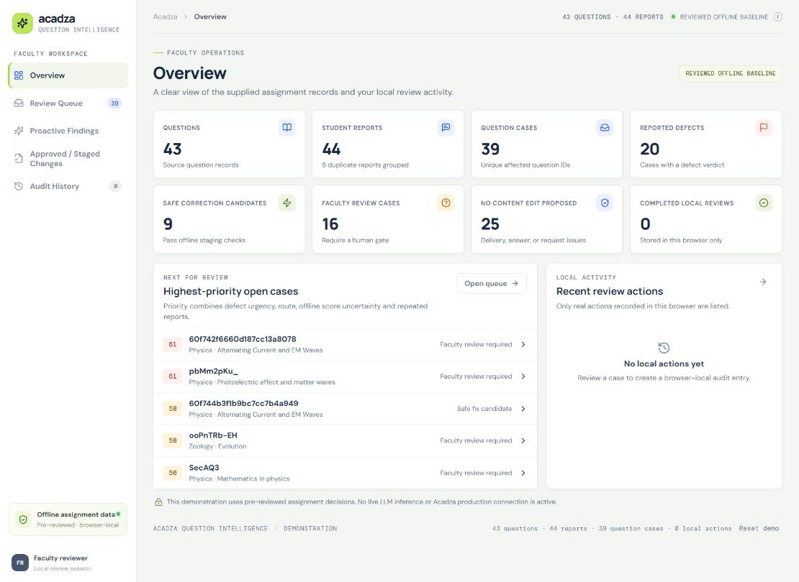
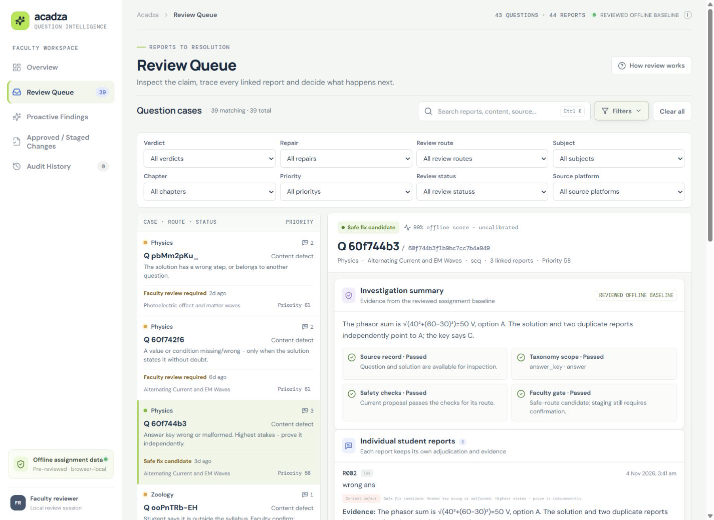
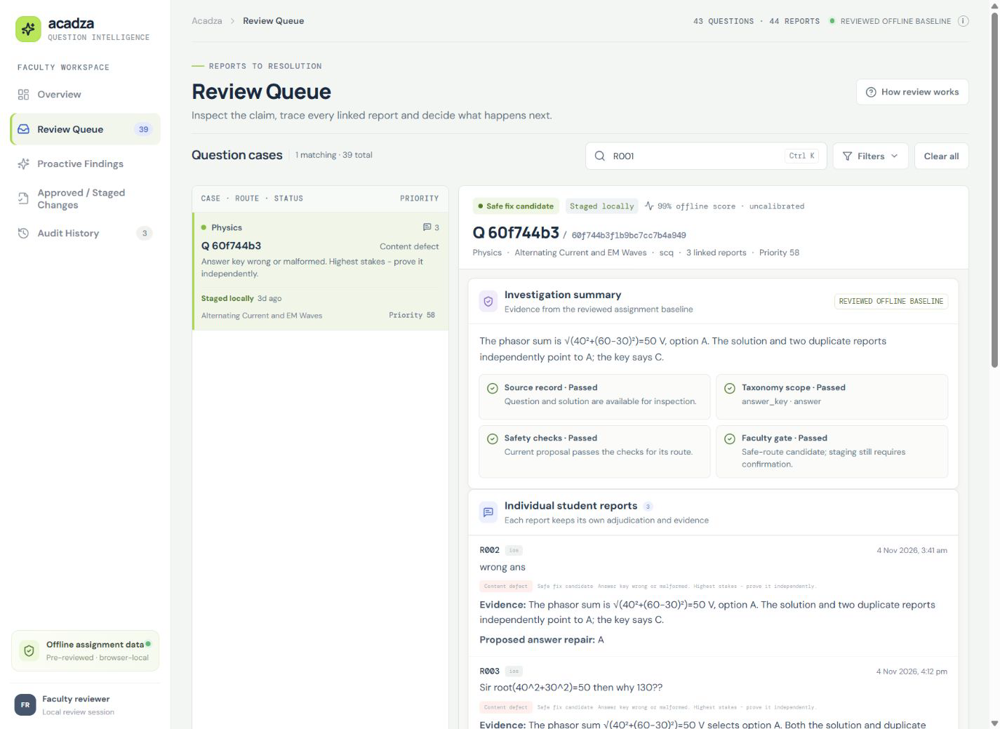
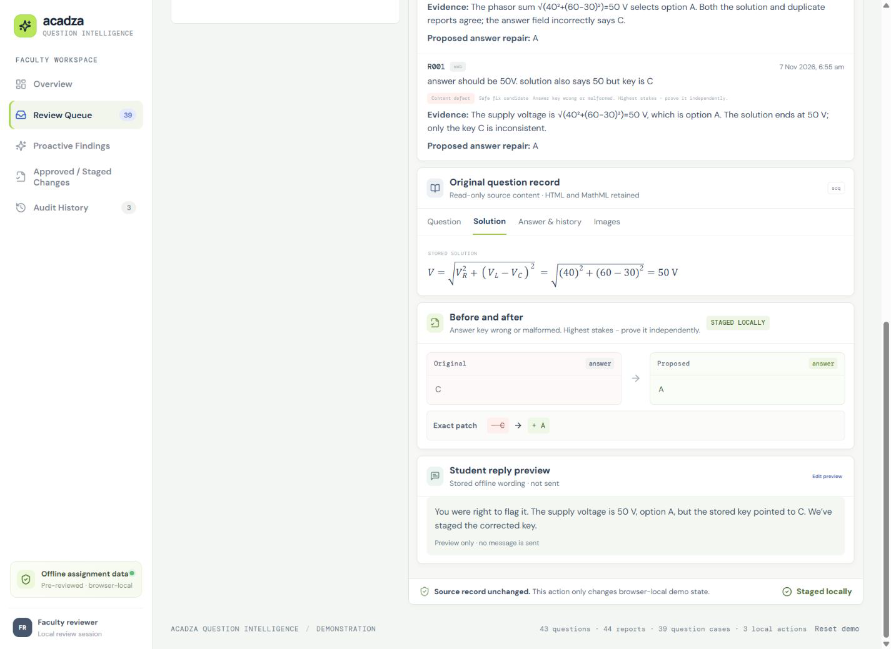
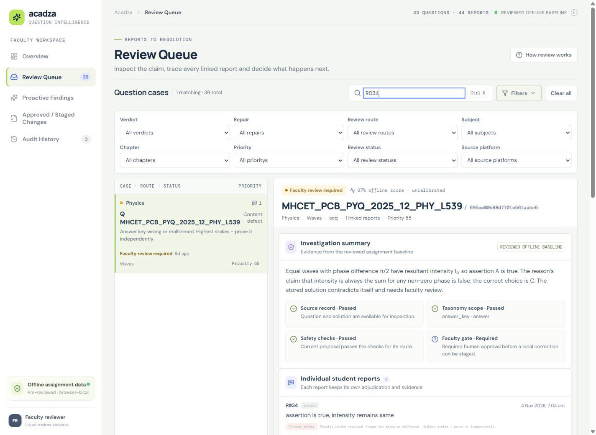
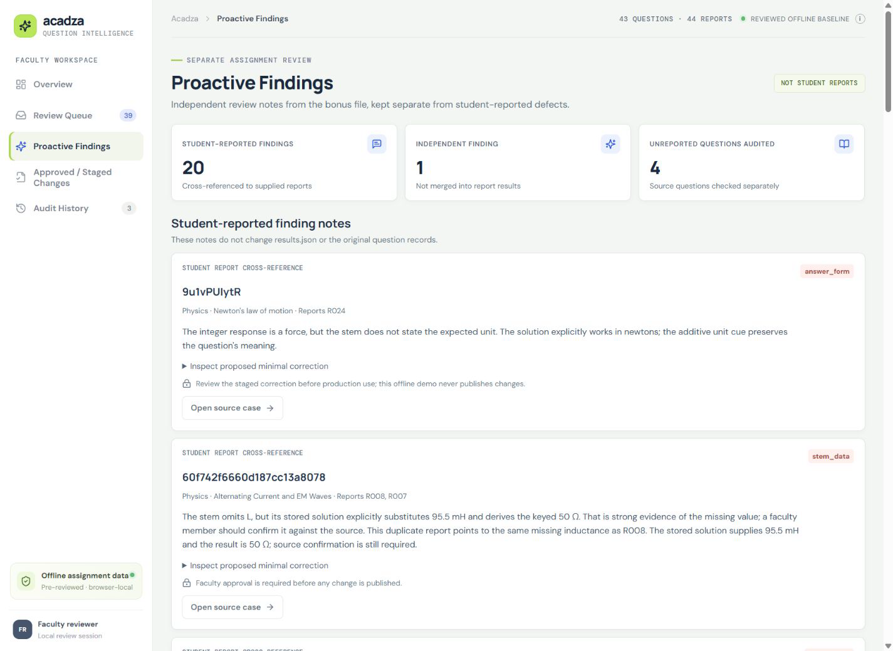
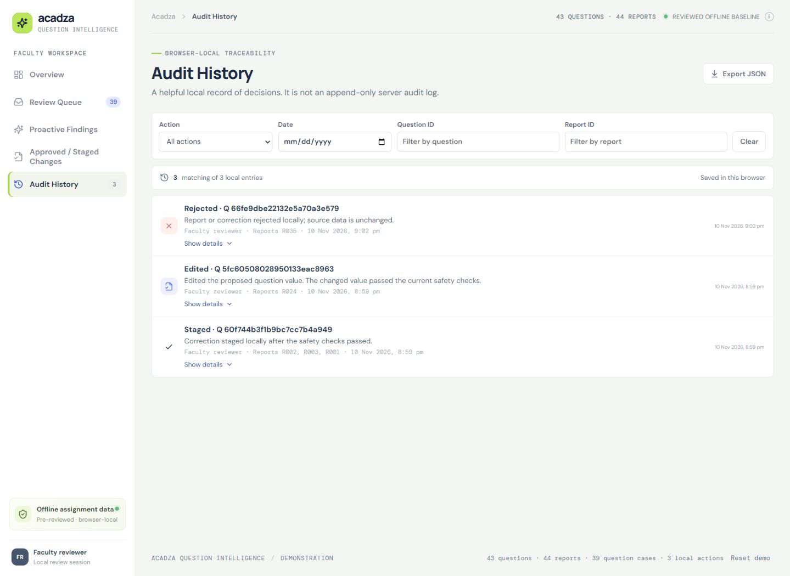
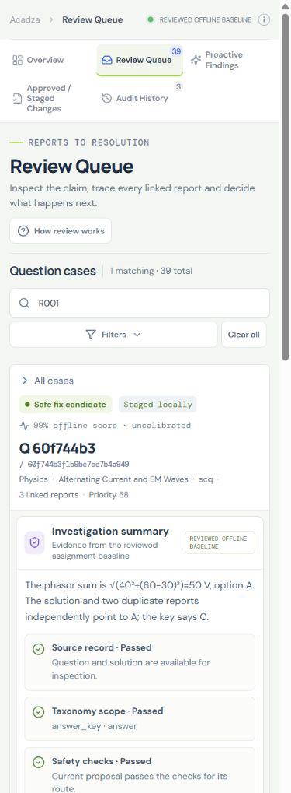

# ACADZA | Question Intelligence

**A faculty-facing review console for the supplied Acadza assignment snapshot.** The app groups reports by their question record, shows each report's offline adjudication, displays read-only question content and scoped proposals, and records local review actions.

> **Demonstration only:** decisions are pre-reviewed offline assignment data. The app does not call a live LLM, connect to Acadza production, publish corrections, or provide server-side audit guarantees. Faculty decisions persist in the current browser's local storage.

## Screenshots

All views use records from the assignment snapshot. The mathematical example is the R001–R003 answer-key case; faculty review and no-error examples remain separate.

### Overview



### Review queue and investigation









### Proactive findings and audit





### Mobile review



## Assignment data

- 43 source questions, 44 reports, 39 unique question cases, and exactly 44 report-level results.
- Joins use `reports[].questionId === questions[]._id`; the report list and result schema preserve the original report IDs.
- `results.json` retains the assignment's closed seven-verdict and 18-repair taxonomy.
- Results remain report-level: 11 `auto_apply` entries group into 9 safe correction cases, and 19 `faculty_review` entries group into 16 faculty cases. The other 14 results are `no_change` cases. The queue presents these 39 grouped cases while preserving all 44 individual report results.
- `bonus_findings.json` is presented separately from student-reported adjudications.
- Source question and report JSON are read-only in the app. Question HTML and MathML are rendered through DOMPurify; answer values retain their original type.

## What the app does

- Five sections: Overview, Review Queue, Proactive Findings, Approved / Staged Changes, and Audit History.
- Queue search covers report IDs, question IDs and QIDs, subjects, chapters, original comments, question and solution text, stored answers, and source platforms. `Ctrl+K` / `Cmd+K` focuses search; `Escape` clears it or returns from a mobile detail view.
- Combined verdict, repair, route, subject, chapter, priority, status, and source filters.
- A case-level summary plus every linked report's own adjudication, evidence, and proposed repair.
- Read-only Question, Solution, Answer and history, and Images tabs; a source-aware before/after comparison; and a human-required state where faculty review is necessary.
- Central safety eligibility checks before staging or correction approval. Faculty edits are revalidated, answer types are preserved, and content-changing actions require confirmation.
- Browser-local decisions and audit snapshots, audit filtering and JSON export, storage recovery, and confirmed demo reset.

## Run locally

Requirements: Node.js 22.12+ (Node 24 supported) and npm.

```powershell
npm ci
npm run dev
```

Open the local URL printed by Vite, normally `http://127.0.0.1:5173/`. No API key or database is required. The optional model integration is not configured or called in this build.

## Verify and regenerate results

```powershell
npm run lint
npm test
npm run results
npm run build
npm audit
```

`npm run results` validates the source joins, taxonomy, proposal scope and route constraints, then writes root and public result files. The regression suite verifies exact source counts, the strict result schema, report preservation, proposal safety, queue behavior, local state handling, and audit filters.

## Architecture and documentation

The React/TypeScript/Vite client imports the assignment JSON at build time. `src/lib/review.ts` contains case derivation, search/filter helpers, safety eligibility, and browser state handling; `src/lib/route-safety.mjs` is shared by the result generator and action validation. `src/App.tsx` renders the faculty workflow. See [architecture](docs/architecture.md), [safety](docs/safety.md), [testing report](docs/testing-report.md), [demo walkthrough](docs/demo-walkthrough.md), [data dictionary](docs/data-dictionary.md), [data anonymization](docs/data-anonymization.md), and [deployment notes](docs/deployment.md).

## Limits

- Pre-reviewed adjudications are a dataset-specific offline baseline; they are not generated by a live model and do not generalize to new incoming reports.
- No Acadza production connection, authentication, server, database, ingestion path, or write endpoint exists.
- Local decisions are specific to one browser profile and can be cleared. Local audit entries are not server-backed or guaranteed append-only.
- No calibrated confidence probability, multi-user persistence, production rollback, or live deployment is included.
- Assignment question text and anonymous comments are included. Confirm distribution rights before publishing the project publicly.

## Project structure

```text
src/                  React console, style system and review helpers/tests
data/                 Supplied assignment questions, reports, taxonomy, adjudications
scripts/              Deterministic result generation and validation
results.json          Required 44-entry report-level output
bonus_findings.json   Separate assignment audit findings
docs/                 Design, architecture, safety, tests, demo and screenshots
dist/                 Production build output
PROMPTS.md            Master prompt and prompt inventory
PRODUCT.md            Product answers
```
